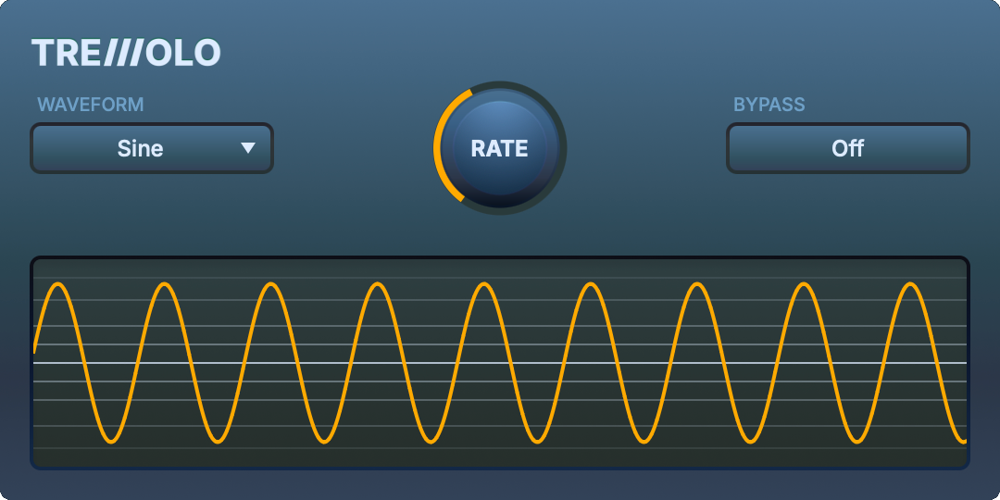

<div align="center">

# Tremolo Audio Plugin

[](LICENSE.md)




A cross-platform real-time **Tremolo** audio effect plugin built with modern **C++23** and **JUCE 8**, featuring selectable LFO waveforms, real-time LFO visualization, and DAW state persistence.

</div>

---

## ✨ Overview & Features

* **Multi-Format Support:** Native builds for **VST3**, **AU**, and **Standalone** targets.
* **Real-Time Amplitude Modulation:** Sub-audio-rate tremolo DSP engine with adjustable **Modulation Rate**, switchable **LFO Waveforms**, and click-free **Bypass**.
* **Interactive GUI & Visualization:** Custom user interface featuring a real-time LFO waveform display synchronized with audio processing.
* **DAW State Persistence:** Full XML parameter and state serialization for seamless preset management and project recall.
* **Modern C++ Engineering:**
  * Built in **C++23** with automated dependency management via [CPM.cmake](https://github.com/cpm-cmake/CPM.cmake).
  * DSP unit testing integrated with [GoogleTest](https://github.com/google/googletest).
  * Consistent code style and static analysis enforced via `.clang-format` and `.clang-tidy`.

---

## 📂 Project Structure

```text
Audio-Plugin-Juce-Project/
├── plugin/                  # Core plugin source code (DSP engine, GUI editor, unit tests, CMake config)
├── docs/                    # UI screenshots and visual assets
├── .clang-format            # C++ code formatting rules
├── .clang-tidy              # Static code analysis rules
└── LICENSE.md               # License terms